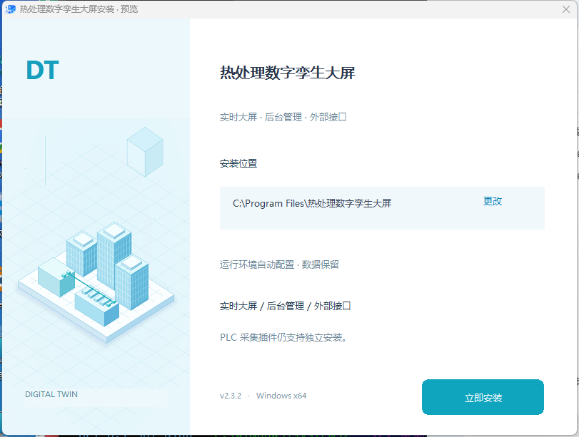
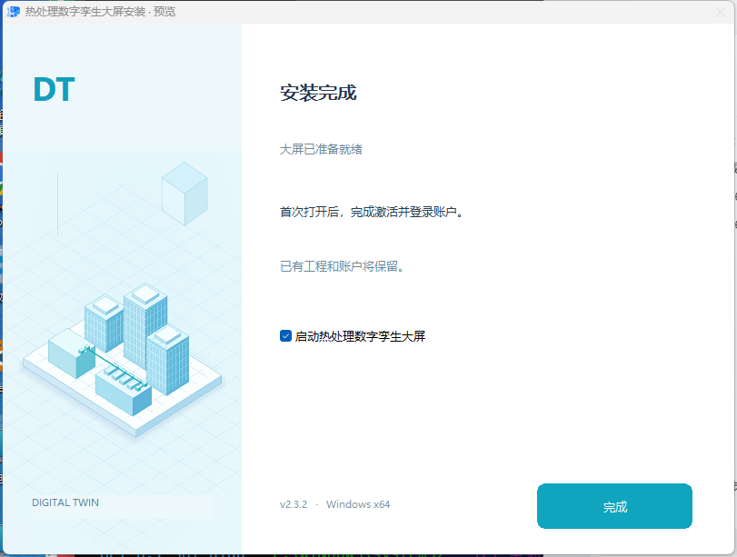

# 安装界面与打包性能（2026-11-05）

## 美术与功能边界

参考提供的图片：浅冰蓝背景、青绿强调色、等距数字孪生建筑、细蓝图网格、白色向导内容区。扩展项目已有的原生绘图资源，不引入浏览器、安装插件或额外运行时。插画源代码为 `desktop/scripts/installer-art.cjs`，原生控件布局为 `desktop/scripts/installer-layout.cjs`。





保留安装路径编辑/浏览与非法路径拦截、安装进度/错误详情、完成后启动、桌面/开始菜单入口、WebView2/VC++ 自动准备、需要重启时不启动且不自动重启、升级时保留账户和工程、卸载保留用户数据、独立可选 PLC 采集插件、空系统交付策略。

原生预览已验证正常、重启、失败和取消四种情形；预览不安装大屏、不写注册表、不启动真实应用。另有控件边界和键盘可访问性回归测试。

## 本次确认的瓶颈

1. **每次新目录让缓存失效**：旧流程将 Unity/后台宿主输出设到带时间戳的发布目录，下一次目录必然不存在。改为稳定、发行版专用的缓存目录，不覆盖运行中的开发/现场程序。
2. **后台缓存把自身记录纳入哈希**：记录文件位于输出内，下一次写入记录就使旧记录的哈希失效。现在明确排除成功标记，但仍校验全部真正的输出文件。
3. **前端每次重编，且诊断文件拖慢指纹扫描**：现在只指纹化源码、公共资源、共享代码、构建配置、依赖与相关环境；不扫描测试截图、输出目录和开发日志。复用前检查全部产物内容及文件集合，残留 chunk、缺失和损坏均触发重建。
4. **Windows tar 卡在依赖树**：本机 `tar.exe` 运行 397.799 秒后仍为零字节，主动终止。改用明确声明的构建期 `tar` 依赖、有界 32 jobs 流式归档。相同 19,933 文件的 Node tar 完成用时 115.985 秒、173,893,120 字节；逐文件内容核验通过后才纳入缓存。旧工具未完成，不把它当作一次成功耗时或宣称固定倍数。
5. **同步目录中间文件与重复全量资源哈希**：中间发布树默认放到 `%LOCALAPPDATA%/HeatTreatmentDigitalTwinBuild/<workspace-key>`，只复制最终交付文件回项目的 `安装包`。资源哈希改为 1 MiB 缓冲、8 个有界任务，保留 SHA-256、文件变动检测与确定性清单，不用 mtime 代替内容验证。
6. **编辑中的源码会使重复构建无效**：本轮在固定已提交版本的独立目录构建，避免同时进行的其他功能修改混入发行包；现有工作区改动不回滚、不覆盖。

## 已实测的阶段数据

| 阶段 | 首次/原流程观测 | 缓存或优化后的观测 |
|---|---:|---:|
| Unity 新缓存首次构建 / 缓存命中 | 220.874 秒 | 1.972 秒 |
| 后台宿主独立目录首次构建 / 命中 | 26.680 秒 | 3.581 秒 |
| 前端独立目录冷构建 / 命中 | 24.742 秒 | 4.597 秒 |
| 程序目录打包 | 194.991 秒（前次记录） | 56.259 秒（本次独立构建） |
| 完整程序资源 SHA-256 | 37.749 秒 | 9.726 秒 |

最后一项对**同一资源树及原始基线**实测：1,647 文件 / 1,749 项，基线与优化后的 SHA-256 都是 `46b404280671252e6515c44a2e071e2bf8e943a93900890915fec47fd2f6cb18`。程序目录前后并非严格同输入 A/B 实验，只报告观测，不把差异全部归因于某一项修改。

首次运行 MySQL、迁移/回滚、采集服务首启/重启测试仍然执行，因此完整发布不会等于“仅压缩安装包”的耗时。最终实际耗时见交付目录中的 `build-timings.json`；失败尝试的日志另外保留，不计作一次成功发布。

## 后续美术迭代不用每次全量构建

```powershell
# 快速验收原生界面，不安装软件
npm --prefix desktop run preview:installer

# 只改安装界面：复用已完成、源版本一致且资源哈希完整的发行程序
node tools/installer-repack.cjs "安装包/release-YYYYMMDD-HHMMSS-mmm"

# 修改真实业务代码、Unity、依赖或版本后必须走完整构建
npm --prefix desktop run dist
```

快速重压会拒绝未完成/跳过测试的候选目录、损坏的采集插件、不同版本，以及任何业务源码改动。前后重新核验不可变资源；元数据明确标注 `installer-ui-only` 和复用的完整运行测试，不冒充重新执行了一次完整测试。不要手动删缓存来追求“干净”；缓存失效和强制重建机制已经保留。

安装程序仍默认 ZIP 压缩级别 1。保留 `ELECTRON_BUILDER_COMPRESSION_LEVEL` 覆盖和恢复行为，不使用提高压缩级别来延长每次发布。
