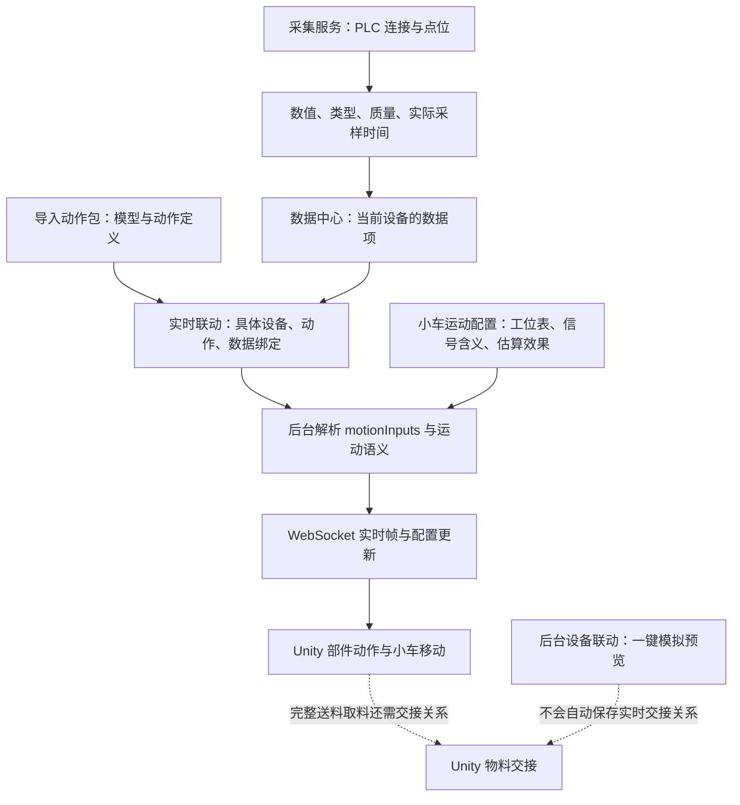

# PLC 到 Unity 动作流程闭环梳理

日期：2026-11-12。对象：当前工作区、独立采集服务和当前工作区 Unity 播放器。

**最新现场复核：** 见《小车进出料闭环复核-20261113.md》。软件隔离验证、实际保存的设备配置、真实 PLC 连通性与 CMD 播放器部署分别验收，不能互相替代。

**2026-11-13 更新：** Ethan 已取消普通小车配置对实际间距、速度/加速度的要求。源码采用“目标工位编号＋到位 BOOL”的简易显示，及默认勾选的“到位时平滑对齐”。设备运动配置页已删除旧表单、高级兼容和切换入口；旧数据仅读取兼容，保存简易配置前不改变原运行设置。详见《小车简易显示与物料交接边界-20261113.md》。下面关于估算参数的内容是 11 月 12 日审查快照，不再作为新配置教程；进出料口页现已补入小车/固定设备进出料信号，并由通用 Unity 物料运行时复用目标工位关系；下面“未形成产品闭环”的结论仅描述当时的历史快照，最新边界与验收见上述 11 月 13 日文档。

## 一、先说结论

**不需要推翻重做。基础技术链路已经连通；但“普通用户少量配置，就能在 Unity 看完整的小车移动、送料、取料”还没有形成完整的产品闭环。**

不能把下面三件事混在一起说成“全部完成”：

1. 一个门、风机、升降机构等动作跟随数据：已有完整链路，本轮重新验证实际 Modbus 采集到 Unity 真实节点。
2. 小车沿导轨移动：已有工位映射和估算移动；前提是正确区分目标工位、当前到位和最后到位编号。普通配置仍有可以减负之处。
3. 小车与另一台设备完整交接物料：底层状态机和双侧动画都有，历史也做过 Unity 隔离验收；但复杂表单删除后，新工程没有相应的简单配置接入口。后台的一键演示没有自动变成 Unity 的实时联动配置。

本轮标准是 Ethan 确认的“显示合理、易配置、不必复刻全部机械细节”，不是把软件改造成 PLC 控制系统。

## 二、历史决策中，哪些仍然有效

已阅读相关聊天的实际用户消息和答复，不只根据聊天列表摘要判断。主要涉及：

| 聊天原题 / 标识 | 本次核对的关键决定 |
|---|---|
| 降低 Unity 动画模型与设备数据延迟；`01a1a542-3d47-7ec2-8a19-1cece1d6a3a9` | 外部 PLC 仿真协议 → 真实采集 → 实际 Unity；数据到达、动作起动、动作时长分别测量 |
| 修复反复要求核对的问题；`01a1bdc3-edb8-7072-8c1e-ed36034a0442` | 曾经只绑定少数动作，不能把局部成功说成全部动作完成；完整工艺循环不能妨碍独立动作 |
| `01a1be9a-3417-7723-aeba-342c10ebb6c7` | Ethan 明确：小车到位才更新工位编号，运动中保留上一工位；不是连续位置采样 |
| 恢复并完成未完成任务；`01a1c524-e84a-71f0-9eff-af83a1d80e5c` | 接受目标工位＋速度/加速度的显示估算；双侧交接；三种布局模板和红色微调范围 |
| `01a1c9b4-a62d-7d01-a155-393bfdebec63` | 一键能看，不能先填精密校准参数；否定夸张长延长带；最终验收以 Unity 而不是 Web 为准 |
| 调整切换工厂按钮样式和位置；`01a1c87d-ddae-7af1-b1d0-81c53ebe36a3` | 11 月 12 日明确删除复杂进出料表单；删除手工动作参数编辑，只保留导入动作包、预览和设备数据绑定 |
| 梳理Unity大屏小车进出料流程；`01a1ceb4-2525-7691-8b82-5f4b109bc9f6` | 一键 Web 演示不是外部 PLC 到 Unity 的验收；历史八工位脚本逐站送入再取回，不是完整车间生产工艺 |

较新的明确决定覆盖旧方案：

- 不恢复手工编辑节点、轴向、行程的动作参数表单。
- 不恢复几十项复杂进出料配置。
- 不恢复长送料桥，不拉长小车或炉体，也不把设备挤到穿模。
- 保留三种产线布局模板；换模型后由用户确认更新布局，不悄悄改已有配置。
- 不要求 PLC 提供实际上不存在的中间百分比。
- 可以做显示估算，但要与真实位置、真实交接完成分开。

## 三、当前真正的数据与动作链路

### 1. 采集层：无需为动画重复接一遍 PLC

`backend/services/plcReader.js`、`collectorWorker.cjs`、`collectorProcess.js` 负责采集与进程隔离。点位的读数、质量、读取时间进入实时数据帧。

数据中心是同一份采集数据的目录，不是第二套采集器。配置动作时选目录里的数据项即可，不应再填一次 IP、地址或重复建立点位。采集服务可以独立于大屏运行；切换后台页面不应中断采集。

**要保留的最低检查：**点位属于这台设备，类型合适，数据确实更新。无需为了看一个门动作先配置历史记录、报警、ERP、进出料口或物料状态机。

### 2. 动作包：解决“模型怎么动”，不解决“哪台 PLC 触发”

当前入口是「模型库 → 动作动画 → 部件动作」中的动作包导入与预览。`ModelAssetTransfer.vue` 和后端 `modelAssetBundle.js` / `modelAssetImportPlan.js` 处理导入、复用和更新。

模型动作是可复用定义；设备点位绑定属于具体设备。导入包后不应该猜现场地址，也不应该要求用户重新手工编写动作。相同模型的其他设备仍需确认各自的数据绑定。

更新包会影响引用共享模型的设备；不能仅凭模型名称把不同资源合并。已有动作 ID 被删除、替换或退役时，应明确提示受影响绑定，而不是显示“保存成功”却静止。

### 3. 实时联动：基础动作已经闭环

「模型库 → 动作动画 → 实时联动」选择具体设备后，`DeviceAnimationLink.vue` 按模型动作建立绑定行。

当前常用配置只需：选择动作 → 选择数据 → BOOL 条件或数值范围 → 显示过渡时间 → 保存并同步。两个到位开关量是可选驱动方式，不是每个动作的前置条件。

后端 `deviceAnimations.js` 保存设备级 `animationBindings`；`motionInputs.js` 将目录身份解析成实际值、质量和时间；`wsServer.js` 广播实时帧。Unity 的 `DeviceAnimationDriver`、`ModelBindingDriver` 负责执行动作，`FactoryRuntime` 负责配置热更新和设备分发。

**动作定义相同，不表示 Three.js 代码直接搬进 Unity。** 两端读取同一模型/动作数据和规则，各自执行渲染。后台预览正常仍不能替代 Unity 验收。

### 4. 小车运动：没有中间点位也可以显示过程，但信号含义不能混

「设备运动配置」已经有从当前产线导入工位、自动读取画布坐标、速度/加速度估算、实际移动反馈和独立到位反馈。

| PLC 实际提供什么 | 现有实现的行为 | 是否需要连续位置点 |
|---|---|---|
| 目标工位 | 开启运动细节模拟，用工位间距、速度/加速度估算途中显示 | 不需要 |
| 当前到位工位 | 直接对齐已经确认的工位 | 不需要，但不能提前知道途中位置 |
| 最后到位编号，运动中仍保留旧值 | 保留旧工位；新到位编号到达后更新，不凭旧值猜目标 | 不需要，但当前模式不会自行播放提前移动 |
| 连续位置/行程 | 按范围跟随，可选有界显示平滑 | 仅现场确有该信号时使用 |

目标工位模式不强制要求独立到位点就能估算显示；独立到位＋实际移动 BOOL 是确认停靠的附加能力。不能为了显示动画就要求现场新加一批点位。

**实际信息缺失的边界：**只有“最后到位编号”，又没有目标工位时，软件无法预先知道下一站。若产品希望仍然平滑，可以另设明确的“收到新到位后的视觉补间”选项；这是可做的简化方案，**不是当前已经实现的提前移动功能**。

当前过重的地方：信号含义藏在高级兼容设置里；估算移动却要求逐段填写现场间距和正加速度。对只求合理展示的用户，建议保留站号对应关系，其余采用显示默认值与预览，真实尺寸/速度另放高级设置。

### 5. 送料、取料：技术能力在，简单配置接入口没有接完

这是本次最重要的闭环缺口。

- 后台 `LineEquipmentSequence.vue` 的一键演示在本地建立场景和时间线，**没有把演示结果保存成设备的实时交接配置**。
- `DeviceAnimationLink.vue` 的普通绑定表单主动去掉 `transferLink`；后端保存普通绑定时只保留旧 `transferLink`，不自动创建新关系。
- Unity 的 `RealtimeTransferCoordinator.cs` 仅在 `animationBindings.transferLink.enabled` 为真时建立交接；双侧完整周期还要求 `cycle.enabled`。
- 因此，旧工程保留下来的关系可以继续运行；新用户导入动作包、绑定推链 BOOL、配置小车移动后，**不会自动获得一套完整物料送料/取料流程**。

结论不是“把复杂表单加回来”，而是需要一个很薄的自动接线层。否则只能分别看到小车移动、推链和炉门动作，却不一定看到连续的物料交接。

## 四、按当前实现，最简可用操作路径

### 普通设备，先让一个动作在 Unity 动起来

1. 在数据中心配置本设备 PLC 连接、点位，确认值和质量更新。
2. 导入该模型的动作包，在部件动作里确认包内动作能预览。
3. 在实时联动里选该设备、该动作、对应数据，设置一个条件和过渡时间，保存并同步。
4. 看 Unity 的真实节点是否随信号变化；不要拿 Web 预览或“设备在线”代替这一步。

不必先设置物料交接、精密坐标、历史期限或完整生产循环。

### 小车额外增加一页配置

1. 从产线导入工位，确认 PLC 工位编号和画布设备的对应。
2. 明确绑定的是目标还是到位编号；有目标信号时启用估算移动。
3. 使用已有速度/加速度和间距设置，保存移动配置。
4. 有实际移动、独立到位信号时再绑定；没有就只做估算展示。

这一条能让小车移动，但不能据此声称完整送料、取料已自动配置。

## 五、建议的简化方向，不再增加一套复杂系统

| 优先级 | 做什么 | 不做什么 |
|---|---|---|
| P1 | 在小车配置增加一个简单的“显示上下料示意”入口，复用已选动作、工位对应设备、动作包料口与现有信号；显示明确的未配置原因 | 不恢复承料节点、公差、物料尺寸、阶段确认等几十项表单 |
| P1 | 将目标/到位信号含义放到第一步；普通估算采用合理的默认时长或速度，先预览再保存 | 不强制用户测现场每段距离、填写精确加速度才能看效果 |
| P1 | 显示端检测采集服务/动作协议是否支持当前功能，更新时成套核对 | 不再出现新界面连旧接口、靠修改错误提示收尾 |
| P2 | 动作包导入后显示“已有动作 → 已绑定几项 → Unity 已应用/缺什么” | 不把导入成功、绑定保存成功直接等同于 Unity 已有动作效果 |
| P2 | 数据选择默认定位当前设备的采集点位表，保留统一目录和外部数据高级能力 | 不重新增加另一套“直接 PLC 绑定”入口 |
| P2 | 清理旧文档和文案；明确“部件动作＝包预览”“实时联动＝现场绑定”“设备联动＝模拟预览” | 不再让已退役的工艺编辑器、长桥方案和严格交接配置冒充当前教程 |

简单示意模式的原则：**能合理看懂，允许默认时长与估算路径；未绑定的精密确认不成为看动画的前置条件。** 若接入了真实反馈，可优先使用；未接入就不能把示意播完标成真实生产完成。

仍值得保留的保护只有直接影响正常使用的几项：不串设备数据、不把断线当正常、动作别争抢同一机械通道、不出现明显穿模或荒谬长结构、已有配置不被自动覆盖。

## 六、本轮重新验证的证据

### 新跑的测试

- 后端：`device-animations-test.cjs`、`motion-data-center-test.cjs`、`boolean-endpoints-test.cjs`、`motion-semantics-test.cjs`、`realtime-motion-queue-test.cjs`、`bidirectional-transfer-test.cjs`、`independent-arrival.test.cjs`、`movement-validation-boundary-test.cjs`、`model-action-package-update-test.cjs`，9 个脚本通过。
- C# 当前源码隔离运行时：`dotnet run --project tools/native-runtime-tests`，54/54 通过。
- 当前工作区 Unity EXE：`node tools/device-animation-native-test.cjs`，实际回环 Modbus → 独立采集 → WebSocket → Unity 清洗机门/泵真实节点，4 类验收通过、135 次 Modbus 读取。验证中间姿态、终点、泵持续转动、断线冻结、恢复，不是只看状态文字。
- 原生验收脚本原先每 5 秒取一次诊断，无法可靠抓住 2 秒动作。本轮仅将隔离测试诊断改为 1 秒；保留中间姿态断言，没有删除检查来放行，未改变现场动画参数。

原始日志在忽略的 `output/flow-audit-*`，现场和测试数据库不提交。原生通过证据目录为 `output/motion-native-live-20261112T153605051Z-33432-qSyaNw`。

### 历史验收，不冒充本轮重测

- 11 月 6 日双到位原生测试：真实 CAD 节点、等待/冲突/过期、同进程动作配置更新。
- 11 月 11 日联动简化测试：三种布局、双侧送料/取料、短行程和设备辊道衔接、Web/Unity 路径对照。
- 11 月 12 日以前的八工位 PLC 脚本：逐站送料再取回，不等于完整的开门、关门、加工、加工结束、取料生产流程。

没有重新验证全部现场 PLC、全部模型组合和完整生产路线；不能把上述局部验收升级为“整个系统彻底没有问题”。

## 七、本机运行状态与本轮修改边界

首次审查本机处于 `simulation`；收尾再次只读核对时，模式已变成 `integrated_plc`，但 9 台设备均为离线、坏质量，采集帧不新鲜。**本轮未操作模式切换；当前实采链路并未连通，动画冻结不能归咎于动作包未播放。** 不能只看模式名称或后台服务在运行就说 PLC 已接通。

PLC 采集、动作绑定、目录解析、移动配置、交接后端等 8 个关键已安装文件与工作区摘要一致；并非整个动作链路都在运行旧代码。

历史设置接口是单独的前后端版本不一致问题。Ethan 已明确要求现在同步本机采集服务，本轮按独立小补丁处理，带数据库备份、代码回滚和原配置指纹核对；不借这个更新改 PLC 模式、点位、动作绑定、模型或工厂画面。

**截至本轮收尾，历史接口尚未部署。** 一次管理员启动返回 Windows“操作已被用户取消”，未执行备份脚本、未停止服务、未替换程序。更新入口和备份/回滚脚本已准备在忽略的 `output/history-live-update-20261112-233052`，需要完成一次系统确认后再核对结果。不能把“准备好更新”写成“本机已更新”。

本轮不恢复旧表单、不新增动作逻辑、不改现场工艺、不执行安装包/发行构建。除上述隔离验收脚本采样修正外，动作产品改造仍是审查建议，不声称已实施。
