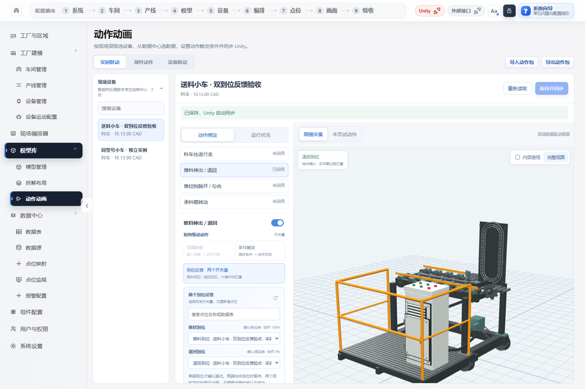
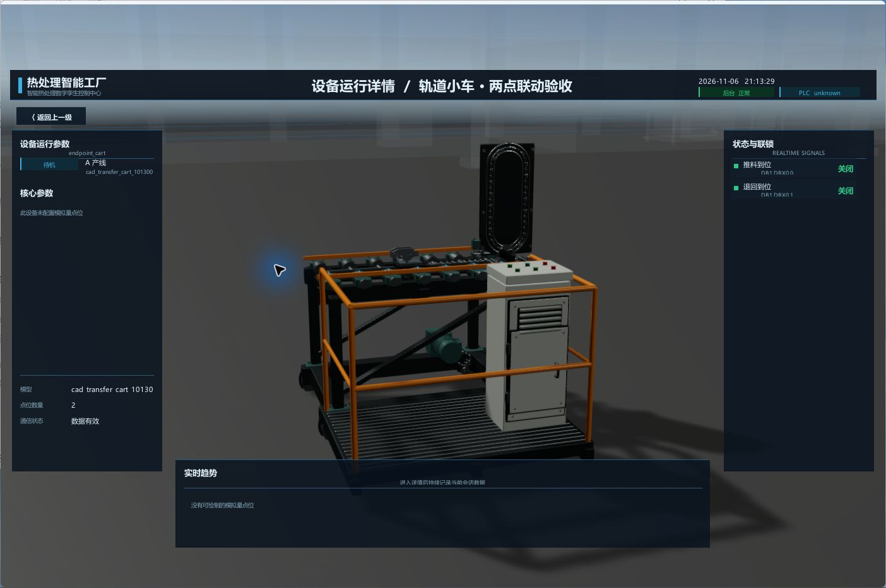
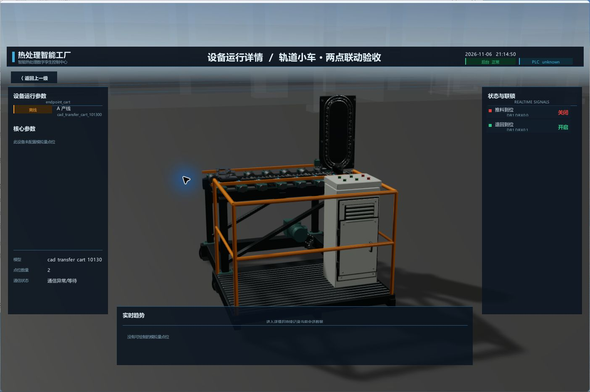

# 双到位联动与 Unity 实机验收 · 2026-11-06

## 已实现

只使用已经有的 **推料到位、退回到位** 两个只读 BOOL，不新增 PLC 点位、不写 PLC。

入口：**模型库 → 动作动画 → 实时联动 → 选择小车 → 推料伸出 / 退回 → 到位反馈·两个开关量**。分别从数据中心选择本设备的两个反馈，保存并同步。不能把同一个实际点位选两次。

| 推料到位 | 退回到位 | 动画处理 |
| --- | --- | --- |
| 关 | 开 | 确认退回端，显示目标 0% |
| 开 | 关 | 确认推料端，显示目标 100% |
| 关 | 关 | 等待，保持当前显示姿态，不猜运动方向 |
| 开 | 开 | 冲突，冻结 |
| 任一缺失、坏质量或超时 | — | 冻结；恢复后读取当前反馈，直接对齐确认端 |

**两个开关量只能确认终点。** 本轮保留 2 秒平滑显示过渡，但它不是实测行程；不把物料自动移入炉内、不确认交接成功、不控制炉门。

## 后台预览与真正 Unity 的一致性

后台使用真实小车 `cad_transfer_cart_101300` 的 `feed` 动作包；Unity 对推料架、齿轮、回链、工作链等全部动画通道逐项核对实际 Transform，与同一动作包采样一致，不是用替代方块演示。

下面后台截图来自当前最终前端及修复后的后台：

## Unity 正常周期原始截图

同一新播放器进程 **PID 6408**、同一观察视角；右侧展示两个测试反馈。截图未经重绘、合成或改变模型形态。输入来自隔离只读注入，不是现场 PLC 验收。

### 1. 退回到位：关 / 开

### 2. 两端都关：等待，仍保持退回显示姿态

### 3. 推料反馈确认：开 / 关，推料架显示到伸出端
对比前两张，推料架由右侧移到左侧；齿轮和链条使用同一动作包联动。

### 4. 再次两端都关：不自行退回，保持伸出显示姿态

### 5. 退回反馈确认：关 / 开，回到初始端

## 显示过渡和异常补充

### 6. 过渡中的显示姿态也能冻结
为获得清楚的中间帧，在隔离输入里先确认推料端，约 0.92 秒后将两反馈都关掉。显示进度停在约 **51.0%**，超过原 2 秒过渡时长也不继续；这是显示冻结演示，**不表示现场推到一半**。

### 7. 重新确认推料端，完成剩余显示过渡

### 8. 两反馈同时开：冲突，推料架冻结

### 9. 坏质量：即使退回读数变为开，也不采信、不退回

### 10. 有效读取恢复：按当前退回反馈直接对齐

### 11. 源停止更新：按实际读取时间超时冻结
原生旧 HUD 可能仍保留最后读数；动画判断使用两个反馈各自的真实读取时间，不能拿旧读数或 HUD 的“数据有效”字样作为到位证据。本轮没有把旧 HUD 的读取值冒充新反馈。

### 12. 停更恢复：读取最新推料端，不续旧计时动画

[首次确认采样原图](assets/boolean-endpoints-20261106/screenshot-20261106-unity-03-extension-transition.jpg) 也保留：其采样窗口从显示过渡跨到端点，图片已接近／到端点，不将它伪称为准确的中间帧。上述第 6 张才是冻结后明确核实的中间显示姿态。

## 新增动作自动同步：已实测，不只是方案

走当前“部件动作”的正常保存 API 新增推拉钩 30° 动作 → 给设备明确绑定已有数据 → 改为 60° → 删除／重新添加 → 快速连续保存。**同一 PID** 的真实节点均更新，播放器 EXE、程序集和原 GLB／动作包哈希整轮未变。

新增的是动作定义，不会自动猜现场数据。新动作仍需选择正确数据并保存绑定；支持的位移、角度、转动、显隐、变色无需每次再编译 C#。

本轮消除了三处重复工作：

- 模型专用事件与通用事件合并，不再两次整厂重载。
- 动画绑定保存只广播一条带工厂／设备身份的 `device-animations` 事件；普通设备布局更新仍正常整厂重载。
- 对真正保留全节点的动作／可拆解模型，复用未变化几何，动作定义和驱动开关变化不再重复导入小车；会影响节点裁剪、材质或优化的设置仍保持缓存敏感性。

最终整轮真实断言：**工厂构建 1 次、小车动作 rig 导入 1 次**；厂房、镜头、无关多用炉根对象保持不变。相同动作及绑定保留原显示姿态／时钟；异步旧结果不会覆盖新配置。

## 速度记录与实测边界

已读取本机相关历史对话：实时链路优化实际记录在 **11 月 4 日**；11 月 5 日主要是安装界面、缓存及打包速度优化。保留 WebSocket 先于动画执行、同帧应用目标等既有改动，不把打包 45.9 秒当成 Unity 运行速度。

最终 16 个样本，在后端重任务退出后采样：

| 链路 | P50 | P95 / 最大 |
| --- | ---: | ---: |
| 本次源成功读取 → 首次实际模型变换 | 11 ms | 26 ms |
| 测试修改 → 首次变换（含 100 ms 采样周期） | 60 ms | 116 ms |
| Unity 接收 → 首次变换 | 2 ms | 4 ms |

动作配置同步：首次新增 **1439 ms**、保存绑定 **1951 ms**、修改动作 **1330 ms**。先前新增／修改约 9 秒的实测和中间失败记录全部保留，不宣传零延迟。

这组是 **隔离注入 → 后台 → 真 Unity**，不是现场 PLC／采集器端到端，也不是全现场 FPS 或硬实时保证。11 月 4 日 PLC 链路 P95 106 ms 与本轮 26 ms 测量起点不同，不能直接算倍数提速；旧 HTTP 组件最大 1981 ms 的尾延迟未在本轮重新消除或重测。

## 验收与应用范围

- 前端完整 1051/1051；最终真实浏览器 8/8、0 页面异常。
- .NET 运行时 22/22；Unity Editor 实际检查 154 项；新播放器 12/12。
- 后端窄事件回归 4 项通过。最终完整后端 **92/93**：`admin-auth` 有一次隔离配置文件持久化失败，单独 17 组复测通过；底层 errno 被旧代码隐藏，不能严谨断言就是 OneDrive 写锁。原失败 result 未改，认证代码未改。
- 本轮未改现场数据库、PLC 地址、原模型资产或正在运行的旧安装版。新双反馈协议需包含本轮运行框架的新版客户端，**不等于旧在用客户端已经升级**；没有发布或替换安装包。
- 13 张 Unity 原始 JPEG 与后台配置截图随本报告放在 `docs/assets/boolean-endpoints-20261106/`，原始图像字节未改变。完整捕获前后实际诊断留在本机；无效桌面观察没有作为 Unity 证据保存。

## 可随仓库读取的证据

- [验收摘要、16 样本统计及截图阶段](assets/boolean-endpoints-20261106/verification-summary.json)
- [Unity 复测说明与历轮对照](../tools/BOOLEAN_ENDPOINTS_NATIVE_TEST.md)
- [双到位使用说明](双到位开关量联动.md)

完整原始日志、逐帧节点数据、测试数据库、会话及编译客户端不上传 Git。完成本轮测试的本机记录：

- Unity：`output/boolean-endpoints-native-player-20261106T130135489Z-12344-zTCasw/` 下的 `result.json`、`screenshot-manifest.json`、`screenshot-verification.json`。
- 前端：`output/boolean-endpoints-frontend-final-audit.json`。
- 后端：`output/boolean-endpoints-notification-regression.json`；包含完整 92/93 与单项复测的未改写记录。
